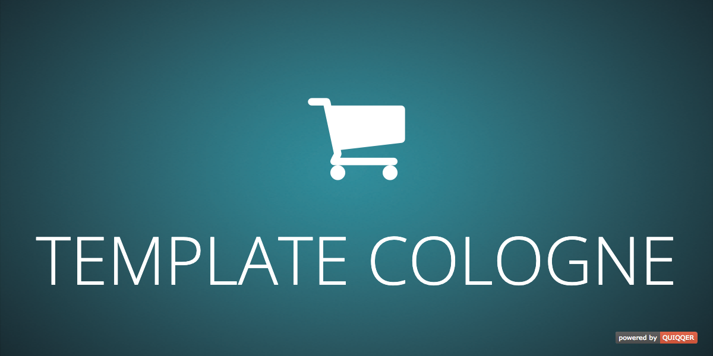

# QUIQQER Template Cologne



Template Cologne is a responsive e-commerce template for QUIQQER. It provides
shop-oriented page layouts, product and basket integrations, configurable
navigation, language and currency controls, and predefined footer content.

## Features

- Responsive layouts with optional left or right sidebars
- Product category, product detail, search, basket, and checkout templates
- Configurable main menu and product category menu
- Language and currency switching
- Brick areas for header, content, sidebar, and footer sections
- Optional predefined footer with legal links, featured products, and payments
- Smooth scrolling for page anchors

## Installation

Install the package through the QUIQQER package manager or Composer:

```shell
composer require quiqqer/template-cologne
```

Assign Template Cologne to the desired QUIQQER project and run the package
setup if the installation process has not done so automatically.

## Configuration

The template settings are available in the project administration. They cover
the logo, header and breadcrumb behavior, navigation, basket interaction,
checkout appearance, language and currency controls, and predefined footer.

Individual sites can override selected layout, header, title, description, and
menu settings through their site attributes.

### Basket navigation

The header and category-menu basket buttons share separate desktop and mobile
click settings. Desktop keeps its existing default (small basket) and also
offers the shopping cart page. At widths up to and including 768 pixels, the
new `templateCologne.settings.basketMobileAction` defaults to the shopping cart
page, including in existing shops. An explicit order-page selection is respected.

The shared navigation JavaScript is loaded only when a page-navigation action
is clicked. The destination lookup then runs via AJAX, not during page rendering.
Opening the small basket or checkout popup does not load this navigation module.

The order-page action prefers a standalone Simple Checkout page and falls back
to an Order page. The shopping-cart action first looks for a cart page and then
uses that same checkout order. If none of the applicable pages is usable,
the visitor stays on the current page and receives a message. The failed click
logs an error with the project, language, setting, effective value, value source
and lookup failures. Successful fallbacks do not log an error. Existing checkout
links and popup actions are unchanged.

This intentionally changes existing order-page selections: when both checkout
site types exist, Simple Checkout now wins. The configuration within the Order
page does not affect destination selection.

This feature requires `quiqqer/order` ^2.21.0. Release the basket Button
extension (`mobileAction` and `getNavigationUrl`) in Order 2.21.0 before
publishing this Cologne version. If the extension ships in a later version,
adjust the minimum dependency accordingly before publishing.

## Smooth scrolling

Add `scrollToLink` to an anchor or button. The target can come from the link's
fragment or from `data-qui-target`; `data-qui-offset` defines an optional pixel
offset.

```html
<a class="scrollToLink" href="#contact" data-qui-offset="80">
    Contact us
</a>

<h2 id="contact">Contact</h2>
```

## Development

Initialize the package-local development tools and run all checks:

```shell
composer dev:init
composer test
```

The checks include PHPStan at level 8, PHPCS with PSR-12, and PHPUnit.

Template events are available around the main header, navigation, page, and
footer regions. Their names are defined in `index.html` and the partial
templates. Package-specific development notes are documented in
[`ECOMMERCE-dev.md`](ECOMMERCE-dev.md).

## Contributing

- [Source code](https://dev.quiqqer.com/quiqqer/template-cologne)
- [Issue tracker](https://dev.quiqqer.com/quiqqer/template-cologne/issues)

## License

GPL-3.0-or-later. See [`LICENSE`](LICENSE).

## Support

For support, contact [support@quiqqer.com](mailto:support@quiqqer.com).
